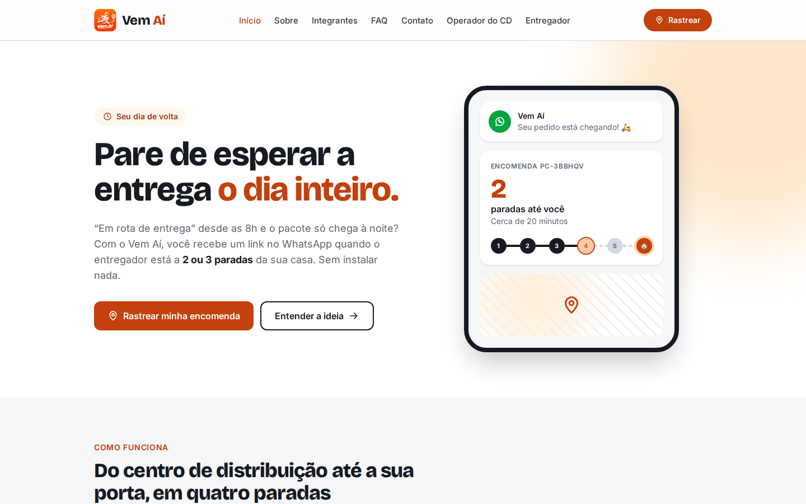
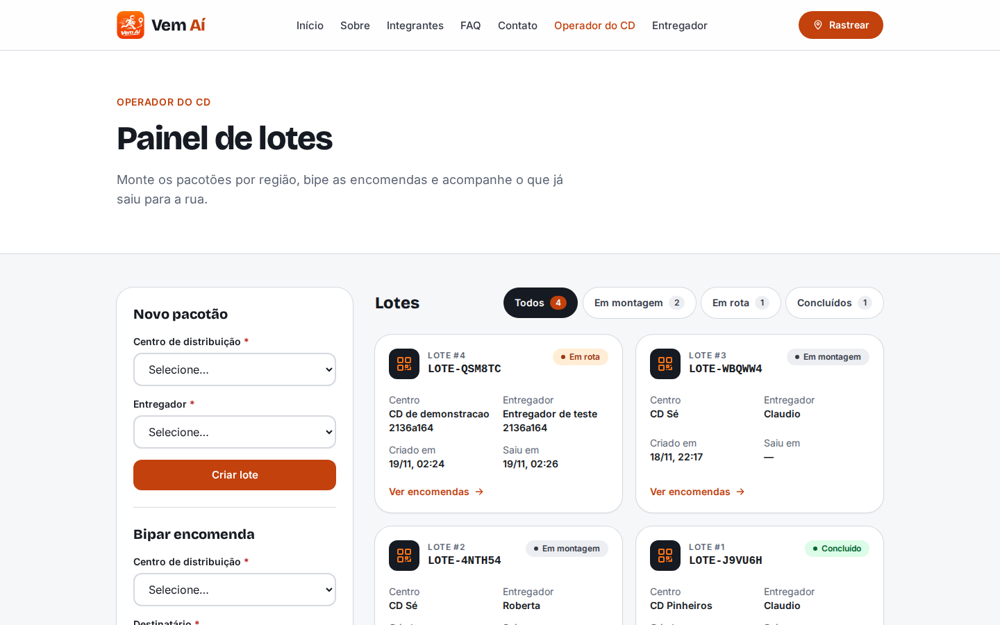
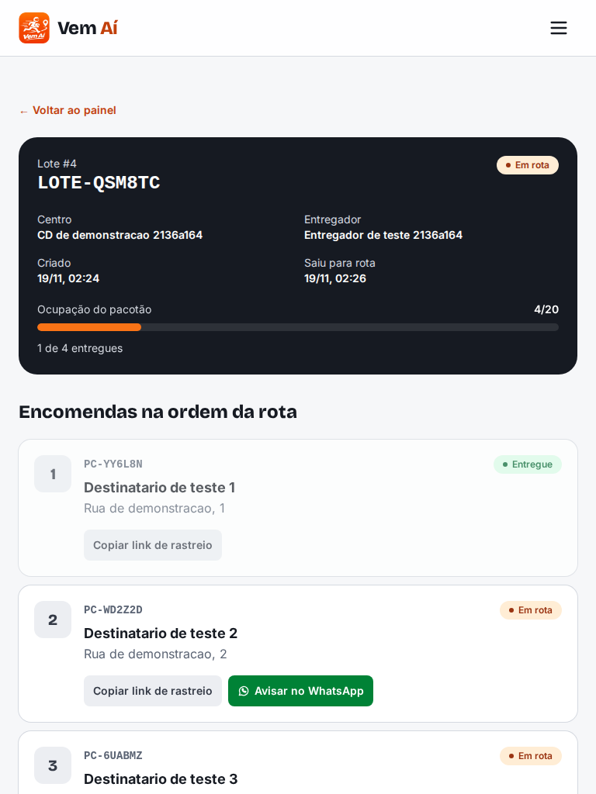
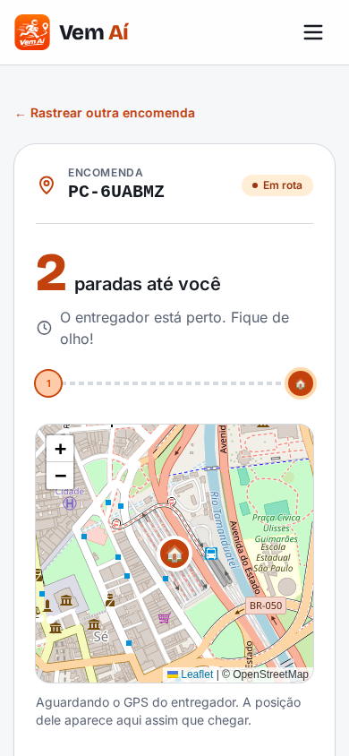
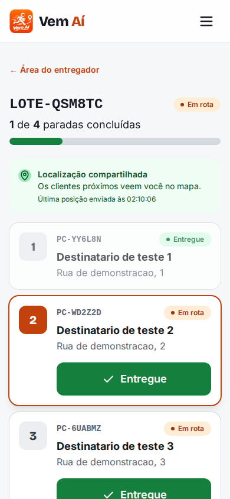

# Vem Aí

> Você só é avisado quando o entregador está a 2 ou 3 paradas da sua casa. Sem instalar app, sem ficar preso em casa o dia inteiro.

Projeto da **Global Solution 2026 · 2º semestre (CitizenTech)**, disciplina de **Front-End Design Engineering** da FIAP, turma **1TDSPJ**.

| | Link |
|---|---|
| 🌐 Aplicação publicada (Vercel) | https://vem-ai-zeta.vercel.app |
| 💻 Repositório (GitHub) | https://github.com/tiagostnz/vem-ai-front |
| ☕ API Java (Render) | https://vem-ai-gs.onrender.com |



## Objetivo

A encomenda aparece "em rota de entrega" às 8h e só chega à noite. Sem saber a hora, a pessoa não sai de casa com medo de perder a entrega.

O **Vem Aí** devolve o dia ao cidadão:

1. No centro de distribuição, o operador junta até 20 encomendas da mesma região num **pacotão** com QR code.
2. O entregador lê o QR e todas as encomendas entram em rota de uma vez, já na ordem das paradas.
3. A cada entrega concluída, o sistema recalcula quantas paradas faltam para cada cliente.
4. Quando faltam **3 paradas ou menos**, o cliente recebe pelo WhatsApp um link com o **mapa do entregador ao vivo**, que abre no navegador, sem app.

Este repositório é o **front-end**: um SPA com três públicos, o operador do CD, o entregador (no celular) e o cidadão, integrado à API REST em Java da disciplina de Domain Driven Design.

**ODS relacionados:** 9 (indústria, inovação e infraestrutura), 10 (redução das desigualdades, pelo acesso sem app) e 11 (cidades e comunidades sustentáveis).

## Tecnologias

- **React 19** + **Vite** + **TypeScript** (modo `strict`)
- **Tailwind CSS v4**, com tokens da marca definidos em `@theme` (`src/index.css`)
- **React Router**, com rotas estáticas e dinâmicas (`/integrantes/:slug`, `/rastreio/:codigo`, `/operador/lotes/:id`, `/entregador/lotes/:id`)
- **Fetch API** para todas as requisições, concentradas em `src/services` (sem Axios)
- **Leaflet** + **OpenStreetMap** para o mapa da entrega
- **Geolocation API** do navegador para a posição do entregador
- **qrcode** para gerar o QR do pacotão no próprio navegador
- **Vercel** para o deploy, com rewrites para as rotas do SPA e proxy da API

## Páginas

| Rota | Página | Integração com a API |
|---|---|---|
| `/` | Home | — |
| `/sobre` | Sobre o projeto e acessibilidade | — |
| `/integrantes` e `/integrantes/:slug` | Equipe e detalhe de cada integrante | — |
| `/faq` | Perguntas frequentes (acordeão) | — |
| `/contato` | Formulário de contato com validação | — |
| `/operador` | Painel de lotes do CD | `GET /lotes`, `/centros`, `/entregadores`, `/clientes` · `POST /lotes` · `POST /encomendas` |
| `/operador/lotes/:id` | Detalhe do lote, QR code e aviso por WhatsApp | `GET /lotes/{id}`, `/lotes/{id}/encomendas` · `DELETE /lotes/{id}` |
| `/entregador` | Login e início da rota pelo QR | `POST /login` · `POST /lotes/iniciar-rota` · `GET /entregadores/{id}/lote-atual` |
| `/entregador/lotes/:id` | Paradas em ordem, confirmação de entrega e GPS | `POST /encomendas/{id}/entrega` · `PUT /lotes/{id}/localizacao` |
| `/rastreio` e `/rastreio/:codigo` | Rastreio público do cidadão, com mapa | `GET /rastreio/{codigo}` (atualiza a cada 20 s) |

Todas as telas que consultam a API tratam **carregando**, **erro** (com botão de tentar de novo) e **lista vazia**.

## Prints

| Operador (desktop) | Detalhe do lote (tablet) |
|---|---|
|  |  |

| Rastreio do cidadão (celular) | Rota do entregador (celular) |
|---|---|
|  |  |

## Estrutura de pastas

```
src/
├── components/      componentes reutilizáveis, separados por área
│   ├── ui/          Botao, Campo, StatusBadge, Aviso, Carregando, EstadoErro, EstadoVazio...
│   ├── layout/      Cabecalho, MenuMobile, Rodape, Layout
│   ├── encomenda/   CardEncomenda, BotaoCopiarLink, BotaoWhatsapp
│   ├── operador/    CardLote, FiltroStatus, formulários de lote e de bipagem, QrLote
│   ├── entregador/  FormularioLogin, FormularioIniciarRota, BotaoEntregue, IndicadorGps
│   ├── rastreio/    FormularioRastreio, MapaEntrega
│   └── home/ faq/ contato/ integrantes/ icones/
├── pages/           uma página por rota
├── services/        chamadas à API Java com Fetch (api.ts centraliza o fetch e os erros)
├── hooks/           useApi, useLocalizacao, useSessaoEntregador, useTitulo
├── types/           tipos das respostas e requisições da API
├── data/            conteúdo estático (integrantes, FAQ)
└── utils/           validação, formatação e link de rastreio
```

## Como rodar

Pré-requisito: **Node.js 20.19+ ou 22.12+** (exigência do Vite).

```bash
git clone https://github.com/tiagostnz/vem-ai-front.git
cd vem-ai-front
npm install
npm run dev
```

Abra o endereço que aparecer no terminal (normalmente http://localhost:5173).

Outros comandos:

```bash
npm run build     # verifica os tipos e gera a versão de produção em dist/
npm run preview   # serve a versão de produção localmente
npm run format    # formata o código com o Prettier
```

### Como o front fala com a API

O front chama sempre `/api/...`. Quem repassa a requisição para a API Java no Render é o **proxy do Vite** (`vite.config.ts`), em desenvolvimento, e o **rewrite da Vercel** (`vercel.json`), em produção. Para o navegador, tudo fica na mesma origem, o que evita bloqueios de CORS.

A base pode ser trocada pela variável `VITE_API_URL` (veja `.env.example`).

> A API está no plano gratuito do Render, que hiberna depois de um tempo parada. A primeira chamada pode levar até 1 minuto. Se uma tela mostrar erro, espere um pouco e clique em **Tentar de novo**.

## Acessibilidade

- Contraste mínimo **AA** (WCAG) em textos e botões
- Foco visível em todos os elementos navegáveis pelo teclado e link "Pular para o conteúdo"
- Botões da tela do entregador com área de toque maior que 44 × 44 px
- Rótulos, erros de formulário e mudanças de status anunciados ao leitor de tela
- Animações reduzidas para quem ativa `prefers-reduced-motion`
- Layout testado em **390 × 844**, **768 × 1024** e **1440 × 900**, sem rolagem horizontal

## Integrantes

| Nome | RM | Turma | GitHub |
|---|---|---|---|
| Tiago Borges Dos Santos | 569926 | 1TDSPJ | [@tiagostnz](https://github.com/tiagostnz) |
| Flávio Luiz Kuratomi Junior | 571211 | 1TDSPJ | [@kkuras](https://github.com/kkuras) |
| João Victor de Jesus Bernardo | 568729 | 1TDSPJ | [@joaovjbernardo](https://github.com/joaovjbernardo) |
| Pedro Andreotti Pugliesi | 569357 | 1TDSPJ | [@PedroAndreottiPugliesi](https://github.com/PedroAndreottiPugliesi) |
| Henrique Osuka | 571324 | 1TDSPJ | [@HenriqueOsuka](https://github.com/HenriqueOsuka) |

## Contato

- Página de contato: https://vem-ai-zeta.vercel.app/contato
- LinkedIn dos integrantes: https://vem-ai-zeta.vercel.app/integrantes
